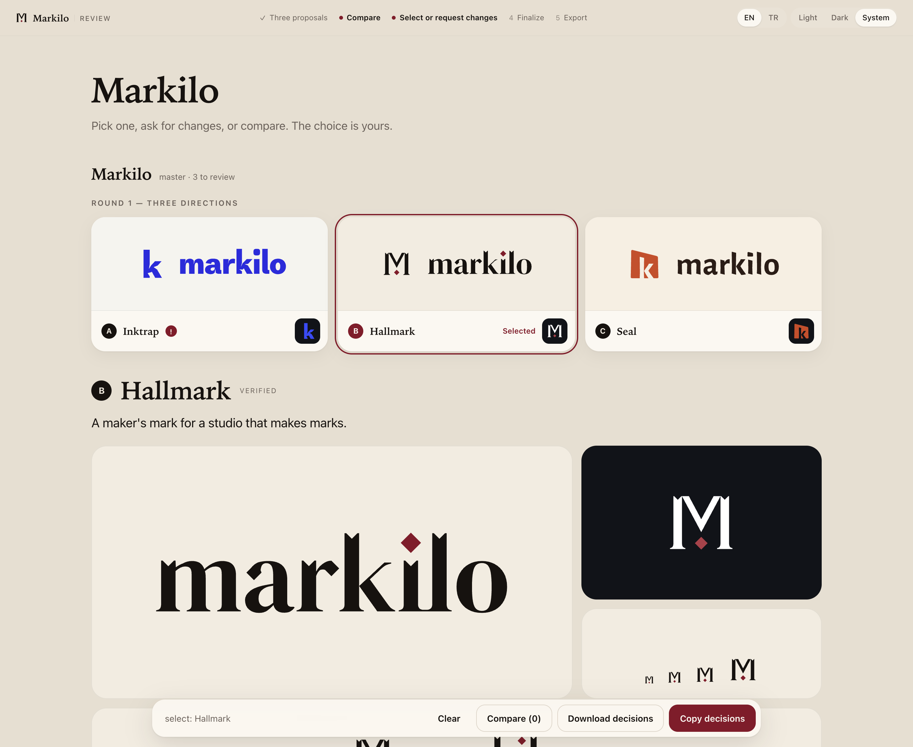
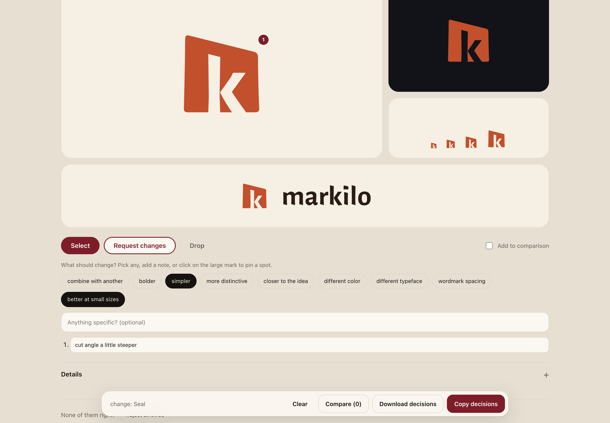
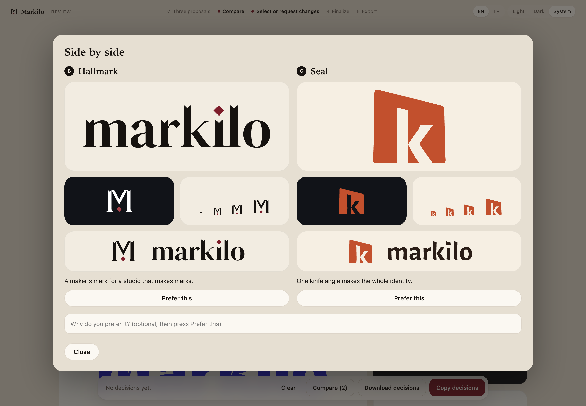
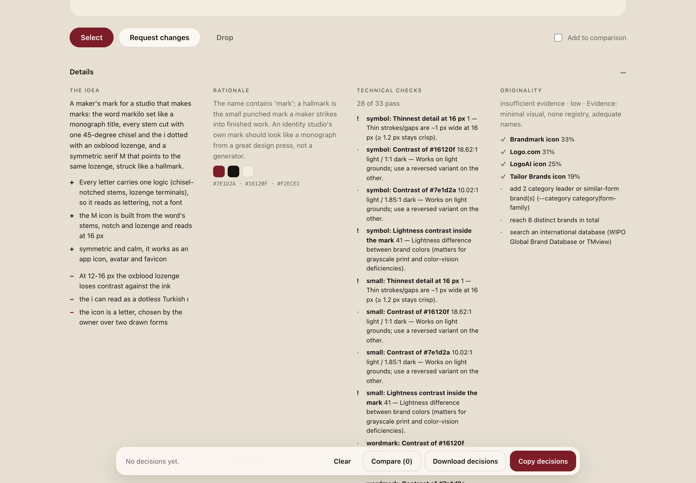
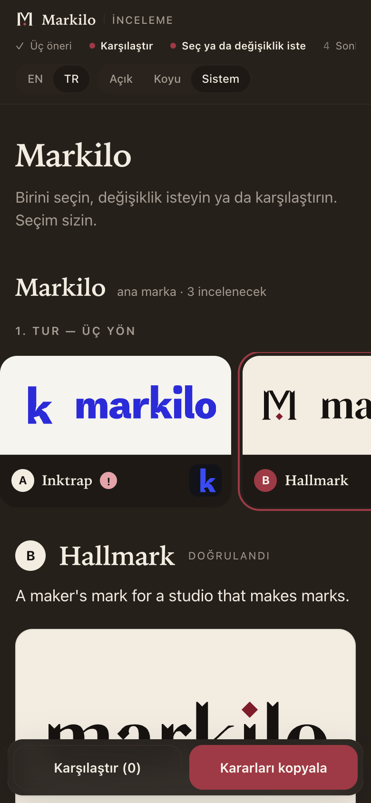
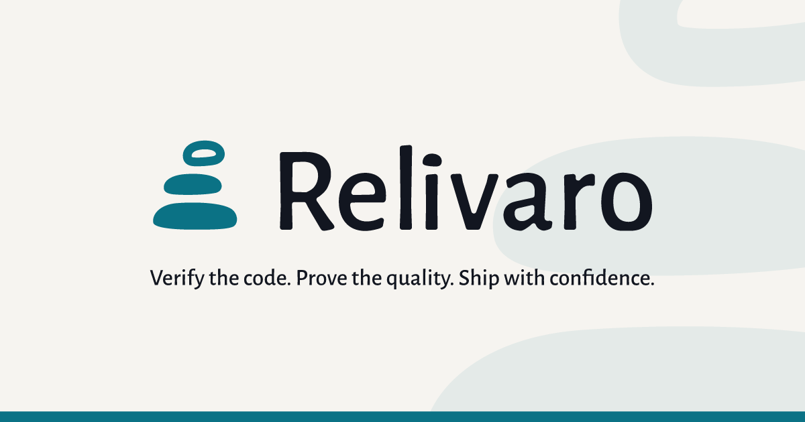
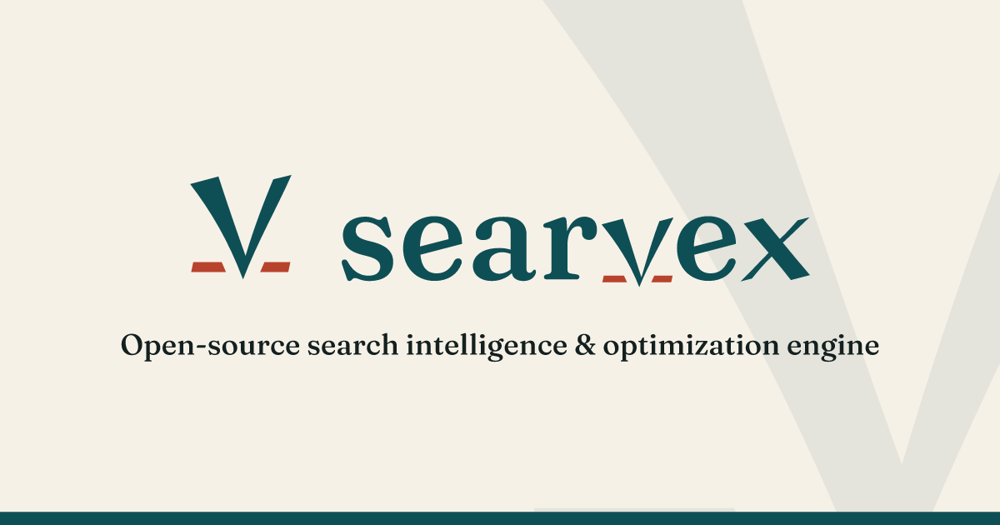
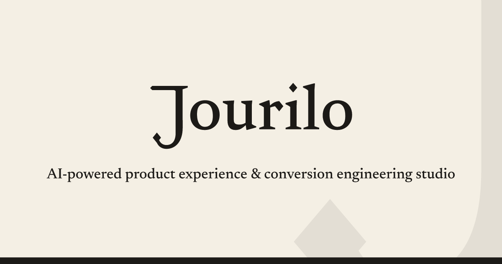
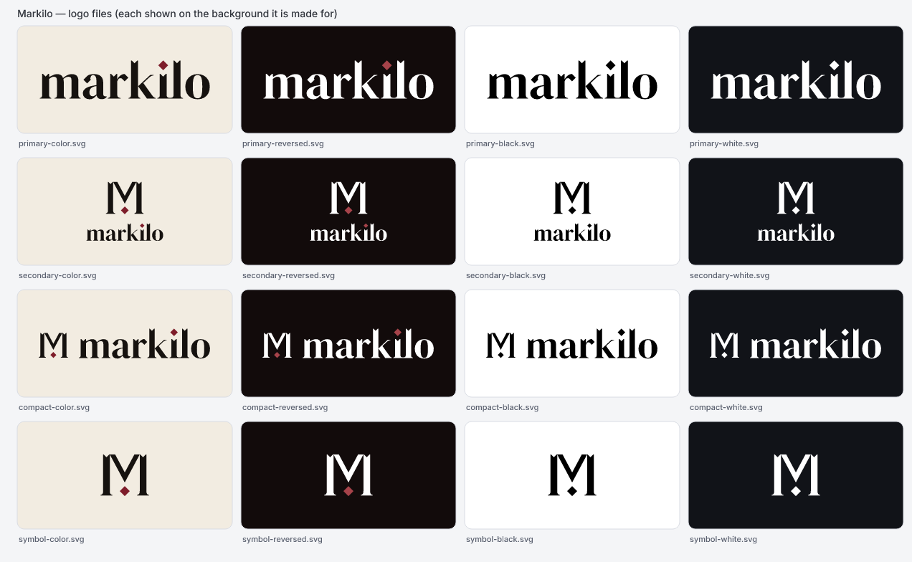
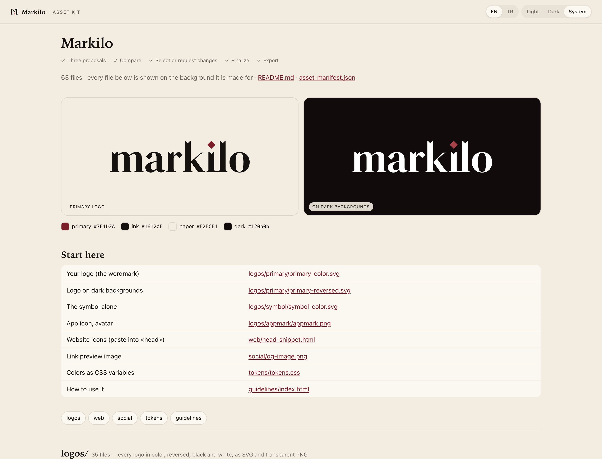

<p align="center">
  <picture>
    <source media="(prefers-color-scheme: dark)" srcset="https://raw.githubusercontent.com/cihantopac/markilo/markilo--v1.7.0/assets/logo-dark.svg">
    
  </picture>
</p>

<h3 align="center">A brand identity studio inside Claude Code.</h3>

<p align="center">
  Three original identities, drawn as real SVG. You choose. You get every file.
</p>

<p align="center">
  <a href="https://github.com/cihantopac/markilo/actions/workflows/ci.yml"></a>
  <a href="https://www.npmjs.com/package/markilo"></a>
  <a href="https://github.com/cihantopac/markilo/blob/main/LICENSE"></a>
</p>

<p align="center">
  
</p>
<p align="center"><sub>Markilo's own first round. The one on the board's oxblood ring became Markilo's identity.</sub></p>

## How it works

**1 · Three proposals.** Markilo reads your product, writes a short brief and draws three genuinely different
identities — a word, an icon, a lockup — and checks each for craft and originality.

**2 · You choose.** The review shows one proposal at a time, large, on light and dark and at 16 px. Select one, ask for
changes in your own words, or compare two side by side. Nothing is finalized without your choice.

**3 · The kit.** Logos, app and web icons, social images, tokens and guidelines — exported, measured and checked.

<table>
  <tr>
    <td width="50%" valign="top"></td>
    <td width="50%" valign="top"></td>
  </tr>
  <tr>
    <td><sub><b>Ask for changes.</b> Pick what to change, add a note, or pin a spot on the mark.</sub></td>
    <td><sub><b>Compare.</b> Two or three side by side; say which you prefer and why.</sub></td>
  </tr>
  <tr>
    <td valign="top"></td>
    <td valign="top" align="center"></td>
  </tr>
  <tr>
    <td><sub><b>Details on demand.</b> Strengths, honest weaknesses, checks and originality — one click away.</sub></td>
    <td><sub><b>Anywhere.</b> English or Turkish, light or dark, desktop or phone. Offline, one file.</sub></td>
  </tr>
</table>

Your decisions go back to Claude with one click: **Copy decisions** and paste them into the chat.

## Made with Markilo

Real products, each from one round of three proposals with its owner choosing. These are the files Markilo exported,
unedited.

<table>
  <tr>
    <td width="33%"><a href="https://github.com/cihantopac/relivaro"></a></td>
    <td width="33%"><a href="https://github.com/cihantopac/searvex"></a></td>
    <td width="33%"><a href="https://github.com/cihantopac/jourilo"></a></td>
  </tr>
  <tr>
    <td><sub><b>Relivaro</b> — release engineering. ≈ $15, seven runs while the 1.1 process was being corrected.</sub></td>
    <td><sub><b>Searvex</b> — search intelligence. $11.27: one round, one development, one direct change.</sub></td>
    <td><sub><b>Jourilo</b> — product experience. $5.29: one round, finished as chosen.</sub></td>
  </tr>
</table>

Markilo's own identity came out of the same process: $13.68 for one round and three icon options.

## The kit

<p align="center">
  
</p>

Logos in color, reversed, black and white (SVG + PNG) · favicons, PWA and maskable icons · iOS, macOS, Android and
Windows app icons · Open Graph and social images · design tokens · brand guidelines · a manifest with sizes and
checksums. Every kit opens with a page that shows each file on the background it is made for.

<p align="center">
  
</p>

## Install

In Claude Code:

```text
/plugin marketplace add cihantopac/markilo
/plugin install markilo@markilo
```

Then: `/markilo <your repo, URL or product name>`.

For other coding agents and scripts, the same toolchain is on npm (Node.js ≥ 20.10; macOS, Linux and Windows):

```bash
npm install -g markilo
```

## Cost and limits

- **The toolchain is free.** Rendering, measuring, originality checks and export run locally — no account, server
  or paid service.
- **The design work uses your Claude Code usage.** In validation a round of three proposals cost $5–10 and a finished
  identity $5–15 (API-equivalent; on a subscription it counts against your plan). `markilo cost` tracks it against a
  budget you set (default $12) and stops paid work when it is reached.
- **Steered, it works; unattended, not yet.** With their owner choosing, all three products above reached an identity
  the owner approved — three products and one owner's judgment, not a benchmark. Unattended, 1.0 produced no identity
  a blind judge panel would present. The full record:
  [benchmarks](https://github.com/cihantopac/markilo/blob/main/docs/BENCHMARKS.md) ·
  [1.1 validation log](https://github.com/cihantopac/markilo/blob/main/docs/RELEASE-1.1.md).
- **Not legal advice.** Originality checks compare against the marks Markilo collected; they cannot prove a mark is
  unique or registrable. No trademark registry search is done for you.

## Learn more

[Usage and commands](https://github.com/cihantopac/markilo/blob/main/docs/USAGE.md) ·
[Asset outputs](https://github.com/cihantopac/markilo/blob/main/docs/OUTPUTS.md) ·
[Originality](https://github.com/cihantopac/markilo/blob/main/docs/ORIGINALITY.md) ·
[Architecture](https://github.com/cihantopac/markilo/blob/main/docs/ARCHITECTURE.md) ·
[Other coding agents](https://github.com/cihantopac/markilo/blob/main/docs/INTEGRATIONS.md) ·
[Privacy](https://github.com/cihantopac/markilo/blob/main/docs/PRIVACY.md) ·
[Security](https://github.com/cihantopac/markilo/blob/main/SECURITY.md) ·
[Changelog](https://github.com/cihantopac/markilo/blob/main/CHANGELOG.md) ·
[Contributing](https://github.com/cihantopac/markilo/blob/main/CONTRIBUTING.md)

## License

[Apache-2.0](https://github.com/cihantopac/markilo/blob/main/LICENSE). Bundled fonts are SIL OFL 1.1; see
[THIRD_PARTY_NOTICES.md](https://github.com/cihantopac/markilo/blob/main/THIRD_PARTY_NOTICES.md).
