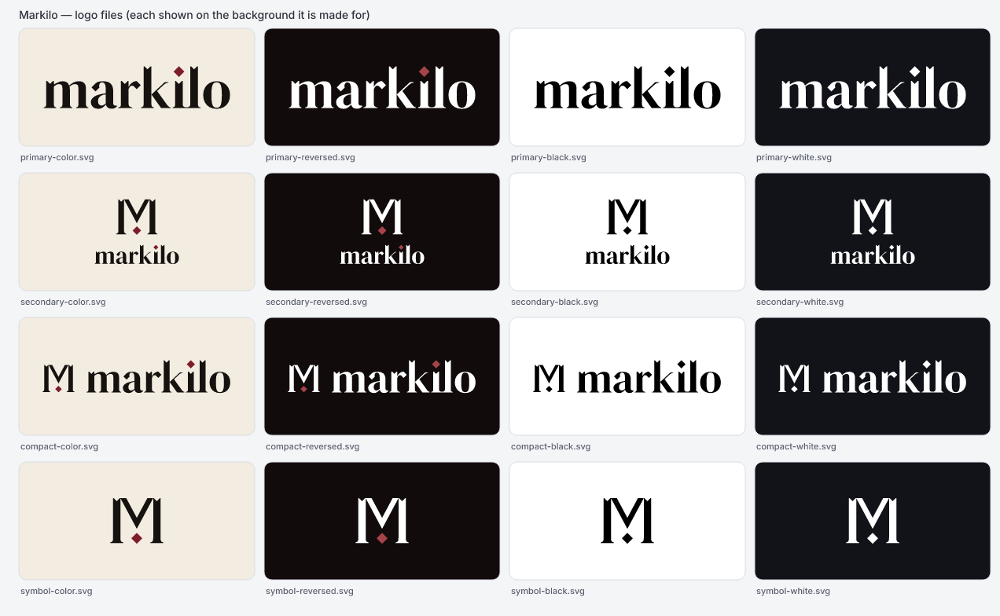
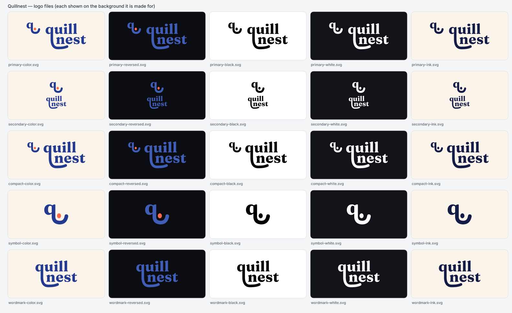
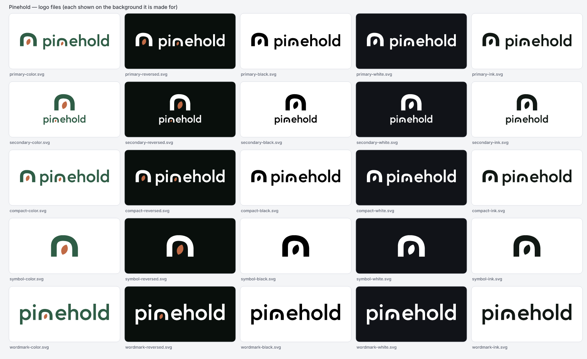

<p align="center">
  <picture>
    <source media="(prefers-color-scheme: dark)" srcset="assets/logo-dark.svg">
    
  </picture>
</p>

<p align="center">
  <b>The open-source brand identity studio for Claude Code.</b><br>
  Research a brand, design original SVG identities, check them against the marks and names you collected, and export every asset you need.
</p>

<p align="center">
  <a href="https://github.com/cihantopac/markilo/actions/workflows/ci.yml"></a>
  <a href="LICENSE"></a>
  
  
</p>

---

Markilo is not a "generate a logo" prompt. It is a Claude Code plugin plus a deterministic toolchain that
**researches** a product, **designs** original vector marks, **measures** them (small-size legibility,
balance, contrast, one-color reproduction), **compares** them against competitors and each other, and
**exports** a complete, platform-correct asset kit — all locally, with no servers, paid APIs or accounts.



<sub>Markilo's identity was made by running Markilo on itself, end to end: repository and market research (64 sources,
37 competitor and category marks), five new directions plus the previous identity, an early sketch review, an
independent critic gate that only one concept passed (`overlap`: two arches sharing a vermilion stem), then finalize
and export. Every image in this README and the plugin icon is an unedited Markilo export (`branding/`). No trademark
registry search has been done yet; the guidelines say so.</sub>

## Highlights

- **Brand intelligence, with receipts.** Repository and website scans, competitor and market research, and a persistent
  Brand Intelligence Profile where every finding is `observed`, `inferred`, `verified` or `user-provided` and carries a
  source and a date. Markilo reads what the product actually does — value proposition, features, audience, surfaces,
  platforms, languages, pricing — and keeps what the product states apart from what it inferred. Unknowns are recorded
  as gaps instead of guesses.
- **Originality engine.** Silhouette overlap under rotation and mirroring, perceptual hashes (aHash/dHash/DCT pHash),
  structural descriptors, palette distance (CIEDE2000), stock-primitive detection, concept-to-concept diversity, name
  confusion (spelling, sound, stems) and trademark pre-screening plans for WIPO, TMview, USPTO, TÜRKPATENT and UKIPO —
  written up as an Originality & Similarity Report with side-by-side overlays. Verdicts say how much evidence they rest
  on — counted in distinct brands, with official, store and catalog sources rated apart: with too few references or no
  logged registry searches the answer is `insufficient-evidence`, never "clear". Calibrated on 24 real brands' logos
  (AUC 0.99; mirrored, rotated and recolored copies always caught; see [docs/ORIGINALITY.md](docs/ORIGINALITY.md)). It
  finds conflicts among what was collected; it cannot prove a mark is unique or registrable.
- **Ideas before drawings.** Every identity starts from a longlist of at least 12 visual hooks from the product, the
  audience, the name, type and abstract character; a critic strikes the ones a stranger would read as a UI glyph or a
  cliché from the words alone, before anything is drawn, and the gallery shows what was kept and why.
- **Real design output.** Symbols built from construction specs — primitives, booleans, gaps, offsets, fillets,
  repeats and real letterforms, compiled with Skia's path engine into clean SVG — and tuned by measured variants.
  Wordmarks outlined from 24 bundled OFL families chosen for the brief's character, with real kerning (Turkish and
  other Latin-extended letters checked in every weight); every changed letter is measured against the font's own
  alphabet, so a word that would be misread ("an e that lost its eye", a dot that reads as a hyphen) is caught before
  review. Lockups aligned to cap height, OKLCH tonal palettes with WCAG pairs.
- **Looks before it talks.** Directions start as cheap sketches that a critical review must pick before any are
  developed. Every concept is rendered to a review sheet (16–256 px, light, dark, black, white) and a context sheet (a
  browser tab, a home screen next to the competitors, a site header, an avatar). An independent critic records a blind
  first impression before it reads the rationale, and only concepts that pass its gate (brand fit, distinctiveness and
  memorability ≥ 6 and "a senior designer would present it") reach you. A first look on the edge of the bar is decided
  by the majority of three cold looks from fresh critics, and the designer can never approve its own work.
- **Complete asset kit.** Logo variants, favicons, PWA + maskable icons, iOS (incl. dark/tinted and Icon Composer
  layers), macOS `.icns`, Android adaptive + themed icons, Windows ICO + MSIX assets, Open Graph and social images,
  marketing templates, design tokens and brand guidelines, with a manifest of sizes and hashes. You get what the
  product needs: a web app gets web, social, tokens and guidelines; app and desktop icon sets are one question away.
- **Brand Preview Gallery.** One offline HTML file comparing concepts on realistic surfaces (browser tab, home screen,
  Dock, store listing, link preview, business card). Pin notes on the mark itself, compare two concepts side by side,
  mark a preferred one, and send the decisions straight back to Claude (`gallery --serve`, local only) or paste them.
- **Monorepo-aware.** Finds the sites, apps and packages of a monorepo, registers the user-facing ones as brands of a
  family, and researches each separately — including existing icon sets and design-system docs.
- **Families and locked brands.** Multi-product families share a system; existing identities can be **locked** so they
  are reproduced byte-for-byte and never redesigned.
- **Fits your stack.** `install-assets --framework auto` puts the files where Next.js (App Router metadata files),
  Laravel, Flutter (Android, iOS and web) or a static site expects them — a dry run first, backups before anything is
  replaced.
- **Not tied to one AI.** Claude Code is home, but the toolchain is a plain CLI: `agent-setup` gives VS Code with
  Copilot, Codex and Cursor the same workflow, with the researcher, designer and critic as sub-agents on the models
  you choose (see [docs/INTEGRATIONS.md](docs/INTEGRATIONS.md)).

## Measured quality

Markilo is benchmarked end to end with nobody steering, on nine realistic products (an independent SaaS, a mobile
app, a multi-product family, a developer tool, an online shop, a B2B platform, a learning app, a feature-flag service
and a team secrets manager). Six of them were **holdouts** for a while: written before the changes they test and
never used for tuning until those results were in. The plugin researches, writes the brief, designs, critiques, and
finalizes only what passes its own gate. Blind judges then rate every critiqued concept from the brief and the images
alone. Every run, image and score is in [bench/](bench).

| Version      | Runs                                        | Passed the gate          | Opus 5.5 judge would present (of concepts it judged) | Time per run | Cost per run (API equivalent) |
| ------------ | ------------------------------------------- | ------------------------ | ---------------------------------------------------- | ------------ | ----------------------------- |
| 0.4.0-rc.1   | 3                                           | 0                        | —                                                    | 11–21 min    | $2.61–3.67                    |
| 0.4.0-rc.2   | 3                                           | 1                        | —                                                    | 8–15 min     | $1.60–2.68                    |
| 0.4.0-rc.3   | 3                                           | 2                        | 0 of 2 (the two that passed)                         | 14–24 min    | $3.15–4.37                    |
| 0.4.0-rc.5   | 9 (6 on holdouts)                           | 2                        | 0 of 12                                              | 10–19 min    | $2.29–4.41                    |
| 0.4.0-rc.7   | 11 (2 new holdouts)                         | 0                        | 2 of 5 — both rejected by the gate                   | 6–16 min     | $1.66–3.30                    |
| 0.4.0-rc.8   | 9                                           | 0                        | 0 of 3 — the recalibrated gate agreed on all 3       | 8–18 min     | $1.91–3.48                    |
| 0.4.0 (rc.9) | 9                                           | 2                        | Portwise 2 of 4 looks, Dozeline 0 of 4               | 14–28 min    | $3.00–7.13                    |
| 0.5.0-rc.1   | 9 (4 on new holdouts)                       | 2                        | 2 of 29, the two that passed (3/3 and 2/3 looks)     | 14–36 min    | $3.37–5.86                    |
| **1.0.0**    | **14 (5 sealed holdouts, 9 on real tools)** | **2, both false passes** | **0 of 43 (Opus + Sonnet panel)**                    | 21–35 min    | $6.85–13.87                   |

What this shows, plainly:

- **1.0 did not make unattended work better, and says so.** On five briefs sealed before any 1.0 change and on three
  real developer tools, an independent panel (Opus and Sonnet, blind) would present none of the 1.0 concepts; it would
  not have presented the 0.5.0-rc.1 ones either. The two 1.0 gate passes were edge passes the panel rejected; the
  gallery now marks such passes "at the edge". What 1.0 did improve is everything around the design: safety, the
  install transaction, letter checks, typefaces, the critique process and the evidence. See
  [bench/results/1.0.0](bench/results/1.0.0).

- **Unattended, Markilo still rarely reaches its own gate** — 6 of the 47 validation runs since rc.5, 2 of 12 on
  briefs that were still untouched holdouts when they ran.
- **For the first time, what passes is what a strict judge would present.** In 0.5.0-rc.1 the gate and the Opus judge
  (the majority of three looks per concept) agreed on all 29 critiqued concepts, and both identities that passed —
  Quillnest, and Pinehold on a brief written for this round — were presentable to the judge. In 0.4.0 the two that
  passed split it 2 of 4 and 0 of 4.
- **Words beat invented symbols.** Both passes were wordmark-led: the name drawn from a real typeface with one letter
  changed, the icon cut from it (2 of 13 judged presentable; invented symbols 0 of 16). Symbols assembled from
  rectangles, circles and polygons keep reading as UI icons or objects — a power button, a wallet, an eye.
- **Reworking a failed idea does not work, so Markilo stopped doing it.** Of 34 concepts sent back after a failed gate
  in earlier rounds, one passed later, after three rounds. The gate now says `fix` once or `reject`; in rc.1 one
  concept got a fix round, and the budget went to more directions instead (43, up from 27).
- **How the gate got here was measured.** The critic's scores given after reading the rationale barely tracked the
  strict judge (Spearman 0.20 on 32 concepts), a cold look did much better (0.51); the gate rests on the cold look.
  Across all runs the gate and the judges agreed on 77 of 86 critiqued concepts. When nothing passes, Markilo says
  so and nothing is finalized or exported.
- **What moved the needle was measured, not guessed.** Hairline gaps came from Markilo's own guide; clichés reached
  development because the sketch review picked the best of weak boards; the name's initial with a cut became the
  default move once objects were ruled out; same-colour layers left seams. Each was found in the runs and fixed in
  the plugin. The model was not the bottleneck (Opus 5.5 as designer did no better on the SaaS brief).

Markilo is built to work with you: you pick the sketch to develop, react in the gallery and decide. Unattended runs
measure the floor. The two that passed in 0.5.0-rc.1, as exported (fictional products, no human edits):

<table>
  <tr>
    <td></td>
    <td></td>
  </tr>
  <tr>
    <td><sub>Quillnest (writing coach for teenagers): passed the gate; Opus judge "present" in 3 of 3 looks, 6.3 — "a
    smiling face built from a q, with the orange dot as a nose".</sub></td>
    <td><sub>Pinehold (secrets manager for small teams, a fresh holdout): passed the gate; Opus judge "present" in 2 of 3
    looks, 6.3 — "an arch or doorway sheltering an orange seed".</sub></td>
  </tr>
</table>

## Install

Requirements: [Claude Code](https://code.claude.com) and Node.js ≥ 20.10. Nothing else — the toolchain ships prebuilt
(pure JavaScript + WebAssembly) and works on macOS, Linux and Windows.

In Claude Code:

```text
/plugin marketplace add cihantopac/markilo
/plugin install markilo@markilo
```

Or from a terminal:

```bash
claude plugin marketplace add cihantopac/markilo
```

```bash
claude plugin install markilo@markilo
```

To update later: `claude plugin marketplace update markilo`, then `claude plugin update markilo@markilo` and restart
Claude Code.

Without Claude Code — for other coding agents ([docs/INTEGRATIONS.md](docs/INTEGRATIONS.md)) and scripts — the same
toolchain is on npm:

```bash
npm install -g markilo
```

Then `markilo help`; to run without a global install, use `npx markilo <command>`.

### `/markilo` and `/markilo:design`

After installing, both `/markilo` and `/markilo:design` start the studio (verified with Claude Code 2.1.308). If another
command already uses the name `/markilo` on your machine, Markilo can install a tiny personal skill that forwards to the
plugin. It never touches files it did not create:

```bash
node ~/.claude/plugins/marketplaces/markilo/plugin/dist/markilo.mjs shortcut install --yes
```

(`shortcut status` and `shortcut uninstall --yes` are available too.)

## Use

| Command                                        | What it does                                                                                                  |
| ---------------------------------------------- | ------------------------------------------------------------------------------------------------------------- |
| `/markilo:design <url, repo, name or task>`    | The full studio: discover → research → brief → explore → design → verify → review → refine → export → deliver |
| `/markilo:research <url or repo>`              | Brand Intelligence Profile and brief only                                                                     |
| `/markilo:concepts <brand>`                    | Creative directions and verified SVG concepts                                                                 |
| `/markilo:originality <concept, file or name>` | Similarity analysis, name check and trademark pre-screening plan                                              |
| `/markilo:refine <brand> <concept> <feedback>` | Iterate with verification, then finalize                                                                      |
| `/markilo:export <brand>`                      | Generate the asset kit (optionally install web assets into your project)                                      |
| `/markilo:gallery`                             | Build the Brand Preview Gallery                                                                               |
| `/markilo:audit <logo or brand>`               | Evaluate an existing identity: keep, refresh or redesign                                                      |

Requests can be written in any language; files and reports are produced in English.

### A typical session

```text
you  › /markilo:design ./ — we're launching this as a product, it needs an identity
     › (Markilo scans the repo: package.json, README, existing favicon, CSS colors, fonts)
     › Discover: no real identity yet → mode "new". May I research competitors on the web? (y)
     › Research: 8 competitors, category codes (green + shields everywhere), 3 gaps recorded
     › Brief: 3 questions, each with a suggested answer
     › Ideas: 16 visual hooks; the critic strikes 11 from the words ("a gauge", "a return key"), keeps 5
     › Explore: 3 directions from the kept ideas — "Pulse" monogram, "Lighthouse" pictogram, "Signal" abstract
     › Sketch: 4 quick constructions per direction; you pick in the gallery, with the critic's reading beside each
     › Design: concept-designer agents develop the picks; each iterates on its review and context sheets
     › Verify: "Lighthouse" 71% similar to a competitor reference → reworked from the idea up
     › Critique: blind first look ("reads as: a pin, a drop") then scores; only "Pulse" passes the gate
     › Review: gallery at http://127.0.0.1:…/ — pin a note on the stem, compare, "Send to your agent"
     › Deliverables: a web app → logos, web, social, tokens, guidelines (app icons are one question away)
     › Finalize "Pulse" → Export: 80 files → Next.js detected: 10 files for app/ and public/ (dry run, 0 overwrites)
```

### Monorepos and product families

```text
/markilo:research This is our product family monorepo at ./ — sites in products/, apps in apps/. The Ledger app's existing identity is locked.
```

Markilo runs `research monorepo`, shows you the packages it considers brands, and after you confirm registers them
(with their folders) and scans each one. Work then proceeds family-first: shared system, master brand, sites one by one,
and many apps as one coherent app-icon system. Exports can be copied into any package with
`install-assets --project <folder>` (dry run first).

## What you get

```text
brand/
├── markilo.json                    # workspace: brands, family
├── brands/<slug>/
│   ├── brief.json · profile.json · answers.json · decisions.md
│   ├── research/references/        # competitor marks for comparison (git-ignored)
│   ├── concepts/<id>/              # concept.json, symbol.svg, wordmark.svg, review/*.png
│   ├── reports/                    # originality-<id>.md|json, quality-<id>.md|json
│   ├── final/                      # approved masters + brand.json
│   └── exports/
│       ├── logos/                  # primary, secondary, compact, symbol, wordmark, appmark × color/reversed/black/white/ink (SVG + PNG)
│       ├── web/                    # favicon.svg (dark-mode aware), favicon.ico, apple-touch-icon, icon-*/maskable-*, site.webmanifest, head-snippet.html
│       ├── ios/                    # AppIcon.appiconset (default, dark, tinted), icon-composer/ layers
│       ├── macos/                  # AppIcon.icns, .iconset, full-bleed 1024 for macOS 26+
│       ├── android/                # mipmap-* legacy + adaptive foreground/background/monochrome, anydpi-v26 XML, Play icon
│       ├── windows/                # app.ico, MSIX Assets (scales, target sizes, unplated variants)
│       ├── social/                 # og-image (+dark), GitHub social preview, X header, LinkedIn cover, avatar
│       ├── marketing/              # watermarks, email signature, title slide, business card
│       ├── tokens/                 # tokens.json (W3C DTCG), tokens.css, palette.json
│       ├── guidelines/             # brand-guidelines.md, index.html
│       └── asset-manifest.json     # every file: purpose, size, sha256, source master
└── gallery/index.html              # Brand Preview Gallery
```

Platform sizes and safe zones are kept in [`src/export/specs.ts`](src/export/specs.ts) with the official source for
each requirement (Apple HIG and Xcode docs, Android Developers, Microsoft Learn, W3C/MDN/web.dev, OGP, GitHub, LinkedIn).
See [docs/OUTPUTS.md](docs/OUTPUTS.md).

## How it works

```text
Claude Code  ──  skills/ (process: research, strategy, design, critique)  ──  agents/ (researcher, designer, critic)
                       │  node ${CLAUDE_PLUGIN_ROOT}/dist/markilo.mjs …
                       ▼
Toolchain (src/ → plugin/dist/): XML/SVG lint & optimize · resvg-wasm rendering · shape features & perceptual hashes ·
similarity & genericity · quality scorecard · fontkit wordmarks · lockups · OKLCH palettes · research scanners ·
originality & quality reports · exporters (ICO/ICNS encoders) · gallery · guidelines
```

The rule that keeps it honest: **anything measurable comes from code; anything judged is labeled as judgment.**
Read [docs/ARCHITECTURE.md](docs/ARCHITECTURE.md) and [docs/ORIGINALITY.md](docs/ORIGINALITY.md).

## The toolchain on its own

The same CLI runs without Claude Code — useful in CI or scripts:

```bash
node plugin/dist/markilo.mjs help
```

```bash
node plugin/dist/markilo.mjs compare my-logo.svg competitor.png
```

Examples: `wordmark --text "Acme" --font sora --weight 600 -o acme.svg`, `score logo.svg`, `palette "#f45d2c"`,
`render logo.svg -o sheet.png --sheet`, `name check Acme --against Acmo,Akme`. Every command prints JSON.

## Privacy and permissions

- Everything runs locally, with no accounts, servers or paid APIs. The toolchain reaches the network only in the
  research and font commands (`research site`, `research competitors`, `research app`, `fonts search/add`), which require
  `--allow-network`; the skills ask you first, and before web searches that would reveal unreleased names. Site
  research honours `robots.txt`.
- The repository scanner never opens secret-like files (`.env*`, keys, credentials), and profiles store project-relative
  paths, never your user name or folder layout.
- Markilo writes only inside the brand workspace (`./brand`). Copying assets into your project is a dry run until you
  approve `--apply`; existing files are never overwritten without `--force` and are backed up first.
- `gallery --serve` listens on `127.0.0.1` only, with a random token, and serves only the gallery and approved artwork.
- Raw research captures and competitor references are git-ignored inside the workspace.

Details: [docs/PRIVACY.md](docs/PRIVACY.md) · [SECURITY.md](SECURITY.md).

## Limitations

- **Not legal advice.** Similarity analysis and registry pre-screening do not clear a trademark. No results ≠ unique.
  Use a trademark attorney before adopting a brand.
- Automated similarity measures form, composition, structure and color. **Conceptual** similarity (the same idea drawn
  differently) is judged by the critic agent and by you.
- Reference comparison covers only the marks collected for the brand; collecting good references matters.
- Raster images (PNG/JPEG) are analyzed for similarity; vector tracing of raster logos is not included.
- Icon Composer (`.icon`) files are not written directly; Markilo exports the layer sources to import.
- X (Twitter) image sizes could not be verified against x.com documentation (blocked to automated readers).
- Design quality still depends on the model and on your direction: unattended runs rarely pass the critic gate, and a
  strict independent judge accepts only a few of the marks they develop (see [Measured quality](#measured-quality)).
  On real developer tools with coined names, twelve unattended runs produced no identity an independent panel would
  present ([bench/results/1.0.0/real-projects.md](bench/results/1.0.0/real-projects.md)). Markilo raises the floor and
  refuses to hide weak work; taste is a conversation, and the gallery is where you steer it.

## Develop

```bash
npm ci
```

```bash
npm run ci
```

`npm run ci` runs Biome, TypeScript, Vitest (unit, integration and bundled-CLI tests), the build and a check that the
committed `plugin/dist/` matches the sources. `node scripts/smoke.mjs` takes an empty folder to installed assets with
the bundle alone (CI also runs it on the copy `claude plugin install` produces). `node scripts/bench.mjs` runs the
end-to-end benchmark ([bench/](bench)). Plugin evals live in [`plugin/evals/`](plugin/evals) (`claude plugin eval plugin`).
See [CONTRIBUTING.md](CONTRIBUTING.md) and [docs/MAINTAINING.md](docs/MAINTAINING.md).

## License

[Apache-2.0](LICENSE). Bundled fonts are SIL OFL 1.1; see [THIRD_PARTY_NOTICES.md](THIRD_PARTY_NOTICES.md).
